# AWS IAM User Access Management (MFA)
Hands-on AWS IAM project demonstrating user creation, group-based permissions, AdministratorAccess policy assignment, console login, password reset, and MFA configuration with security best practices.


---

## 📖 Project Overview

Amazon Web Services (AWS) Identity and Access Management (IAM) is a service that helps securely manage identities and permissions for accessing AWS resources.

In this hands-on project, I implemented an IAM user access management workflow using the AWS Management Console.

The project includes creating an IAM user, creating a user group, attaching the AWS-managed `AdministratorAccess` policy, reviewing permissions, signing in with IAM credentials, changing the initial password, and configuring multi-factor authentication (MFA).

The objective is to understand how identities, permissions, authentication, and security controls work together in a cloud environment.

### Key Features

- IAM user creation and configuration
- AWS Management Console access
- IAM user group creation
- Group-based permission management
- AWS-managed policy attachment
- Administrator access demonstration
- Initial password reset
- Authenticator-based MFA setup
- Security credential management
- Step-by-step implementation documentation

> **Important:** This is an educational lab. The `AdministratorAccess` policy provides broad AWS permissions and should not be assigned to ordinary users or used unnecessarily in production. Follow the principle of least privilege.

---

## 🎯 Project Objectives

- Understand AWS Identity and Access Management.
- Create an IAM user for console access.
- Organize permissions through IAM user groups.
- Understand AWS-managed IAM policies.
- Assign administrator permissions for a controlled lab.
- Authenticate through the IAM user sign-in page.
- Change the initial console password.
- Configure multi-factor authentication.
- Identify common IAM security risks.
- Document a cloud security implementation on GitHub.

---

## 🛠️ Technologies Used

| Technology | Purpose |
|---|---|
| Amazon Web Services | Cloud computing platform |
| AWS IAM | Identity and access management |
| IAM Users | Individual identities |
| IAM User Groups | Group-based permission management |
| IAM Policies | Define allowed and denied actions |
| AdministratorAccess | Broad administrator permissions for this lab |
| AWS Management Console | Web-based AWS administration |
| Authenticator App | Time-based MFA codes |
| GitHub | Project hosting and documentation |
| Markdown | README documentation |

---

## 🏗️ Project Architecture

```text
                    AWS ACCOUNT
                         |
                         v
                  AWS IAM SERVICE
                         |
             +-----------+-----------+
             |                       |
             v                       v
        Create IAM User        Create IAM Group
             |                       |
             |                       v
             |                Attach IAM Policy
             |                AdministratorAccess
             |                       |
             +-----------+-----------+
                         |
                         v
                 Group Membership
                         |
                         v
                 IAM Console Login
                         |
                         v
                Initial Password Reset
                         |
                         v
                  Configure MFA
                         |
                         v
                 Verify User Access
```

### Implementation Workflow

1. Open the AWS IAM service.
2. Create an IAM user with console access.
3. Create an IAM user group.
4. Attach the intended policy to the group.
5. Select the group for the IAM user.
6. Review and create the user.
7. Sign in using the IAM sign-in URL.
8. Change the initial password.
9. Configure an authenticator-based MFA device.
10. Verify the resulting security configuration.

---

## 🚀 Implementation Steps

## Step 1: Open AWS IAM

1. Log in to the AWS Management Console.
2. Click the search bar at the top.
3. Type `IAM`.
4. Under **Services**, click **IAM – Manage access to AWS resources**.

**Description:**  
I searched for IAM in the AWS Console and clicked the IAM service to manage users, groups, and permissions.

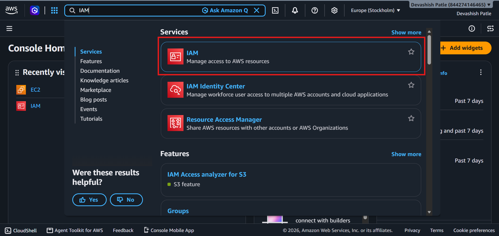

---

## Step 2: Open the IAM Users Section

1. After opening IAM, look at the left-side navigation menu.
2. Under **Access Management**, find **IAM users**.
3. Click **IAM users** (highlighted in the screenshot).
4. The IAM Users page will open, where you can create and manage users.

**Description:**  
I opened the IAM Dashboard and checked the security recommendations. The dashboard shows that MFA is enabled for the root user and that the root user has no active access keys. Then I clicked **IAM users** in the left menu to start creating a new IAM user.

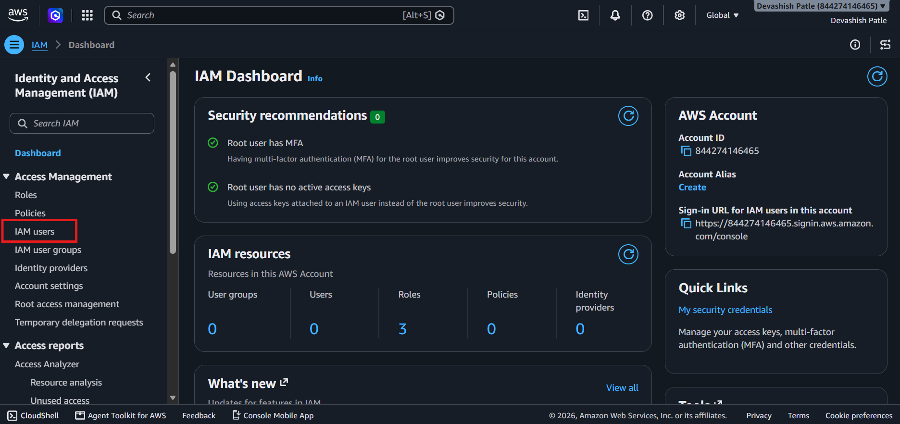

---

## Step 3: Click on Create User

1. Open the **IAM users** section from the left-side menu.
2. On the IAM Users page, locate the **Create user** button in the top-right corner.
3. Click **Create user**.
4. The user creation page will open.

**Description:**

I opened the IAM Users section and clicked the **Create user** button to start creating a new IAM user in AWS.

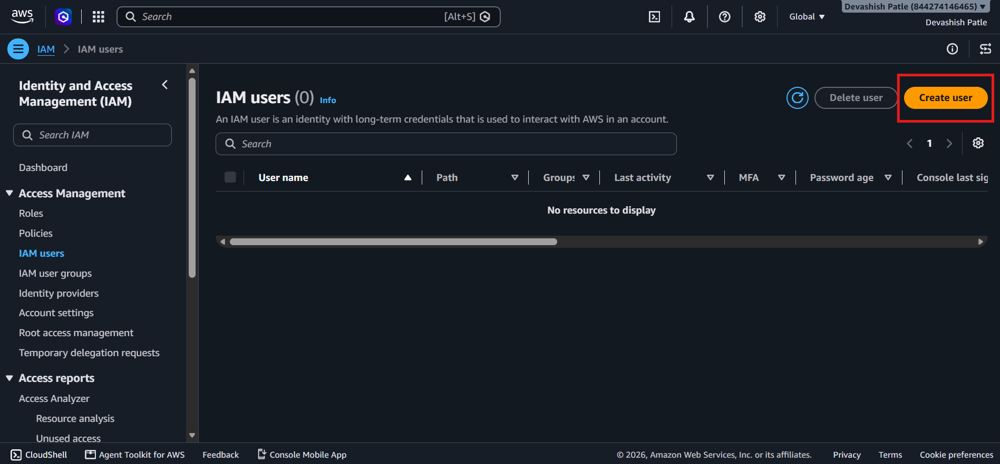

---

## Step 4: Specify User Details

1. Enter the username `Devashish_Patle` in the **User name** field.
2. Select **Provide user access to the AWS Management Console**.
3. Under **Console password**, select **Custom password**.
4. Enter a strong password in the password field.
5. Keep **Users must create a new password at next sign-in** selected.
6. Click the **Next** button at the bottom-right corner.

**Description:**

I entered the IAM username, enabled AWS Management Console access, and configured a custom password. I also selected the option to require a password change at the next sign-in for better security. Finally, I clicked **Next** to continue to the permissions configuration page.

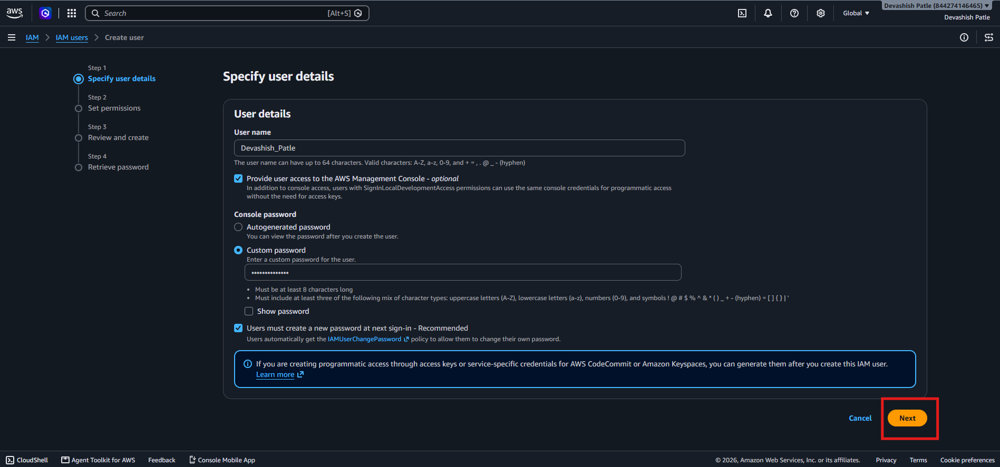

---


## Step 5: Set User Permissions

1. On the **Set permissions** page, select **Add user to group**.
2. Under **Get started with groups**, click **Create group**.
3. You will be taken to the group creation page.
4. Create a group named `Security_Purpose` and configure its permissions.
5. After creating the group, continue with the user permission setup.

**Description:**

I selected the **Add user to group** option to manage the user's permissions through an IAM group. Then, I clicked **Create group** to create a new group and assign permissions to it.

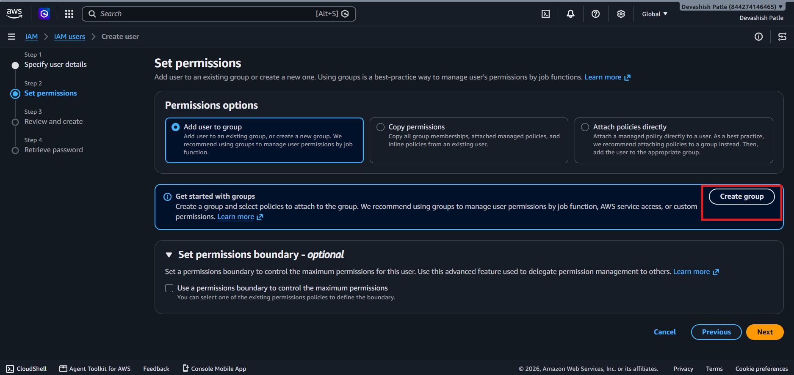

---

## Step 6: Create an IAM User Group

1. Enter `Security_Purpose` in the **User group name** field.
2. In the policy search box, search for `AdministratorAccess`.
3. Select the checkbox next to **AdministratorAccess**.
4. Click **Create user group**.

**Description:**

I created an IAM group named `Security_Purpose` and attached the `AdministratorAccess` policy to it. This policy provides broad administrative permissions to the group. It is used here for learning purposes only.

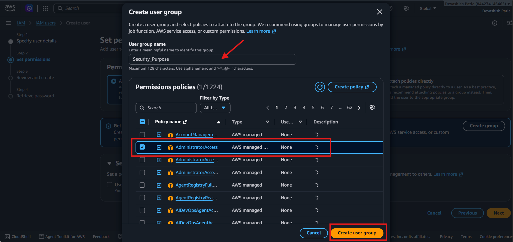

---

## Step 7: Select the IAM User Group

1. On the **Set permissions** page, find the `Security_Purpose` group.
2. Select the checkbox next to the group.
3. Confirm that the group is selected.
4. Click **Next** to continue.

**Description:**

I selected the `Security_Purpose` group to assign its permissions to the IAM user. Group-based permission management makes it easier to manage user access.

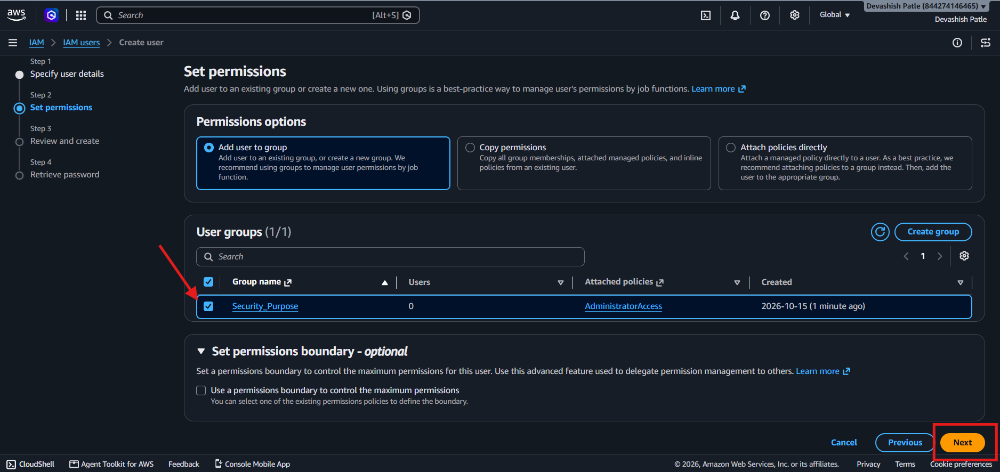

---

## Step 8: Review and Create the IAM User

1. Review the username `Devashish_Patle`.
2. Check the console password settings.
3. Verify that the `Security_Purpose` group appears under **Permissions summary**.
4. Click **Create user**.

**Description:**

I reviewed the IAM user's details and permission settings before creating the user. After confirming the information, I clicked **Create user** to complete the process.

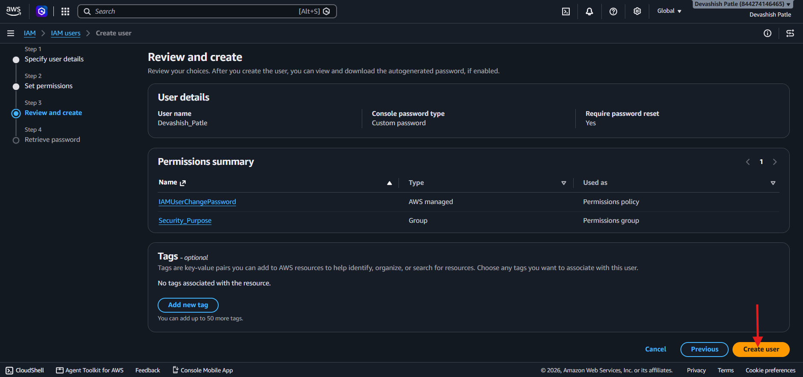

---

## Step 9: Retrieve the User Sign-In Details

1. After the user is created, check the success message.
2. Find the **Console sign-in details** section.
3. Note the IAM username and console sign-in URL.
4. Store the sign-in details securely.
5. Do not share the password publicly.

**Description:**

AWS confirmed that the IAM user was created successfully. I reviewed the console sign-in details so I could sign in using the new IAM user.

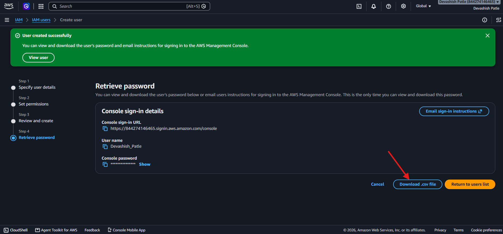

---

## Step 10: Return to the IAM Users List

1. On the **Retrieve password** page, locate the **Return to users list** button.
2. Click **Return to users list**.
3. The IAM Users page will open.
4. Check the user list to locate the newly created IAM user.

**Description:**

I clicked **Return to users list** to go back to the IAM Users page after creating the user. This allows me to view and manage the newly created IAM user.

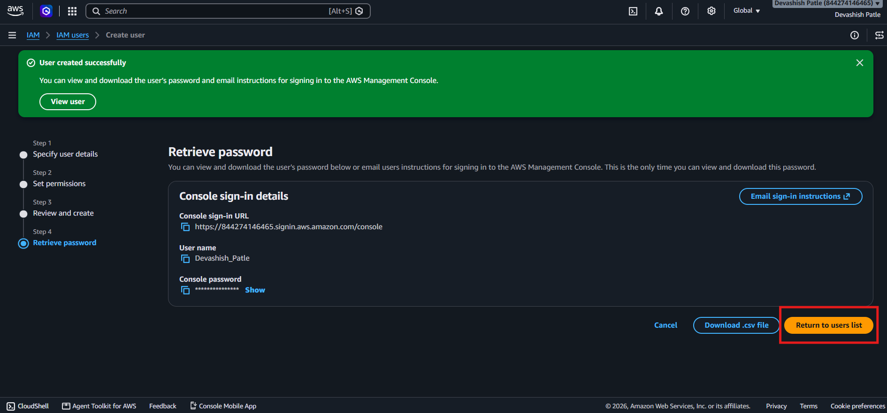

---

## Step 11: Sign In as an IAM User

1. Open the AWS IAM user sign-in page.
2. Enter your AWS Account ID or account alias.
3. Enter the IAM username `Devashish_Patle`.
4. Enter the password.
5. Click **Sign in**.

**Description:**

I signed in to the AWS Management Console using the IAM user credentials created in the previous steps.

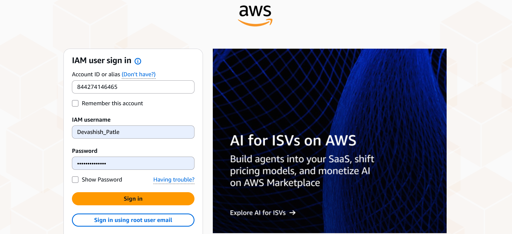

---

## Step 12: Reset the Password

1. After signing in, the password reset page appears.
2. Enter the old password.
3. Enter a new password.
4. Confirm the new password.
5. Click **Confirm Password Change**.

**Description:**

AWS required me to change the initial password at my first sign-in. I entered and confirmed a new password to continue.

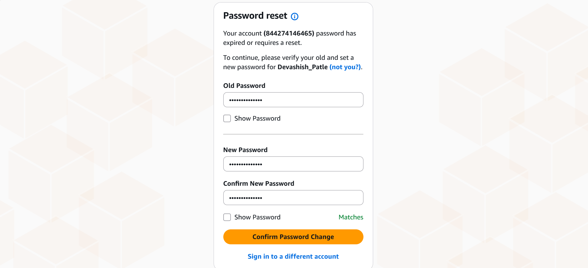

---

## Step 13: Open Security Credentials

1. Open the **IAM** service.
2. Click **IAM users** in the left-side menu.
3. Select the `Devashish_Patle` user.
4. Open the **Security credentials** tab.
5. Find the **Multi-factor authentication (MFA)** section.
6. Click **Assign MFA device**.

**Description:**

I opened the IAM user's security credentials and selected **Assign MFA device** to add an extra layer of sign-in security.

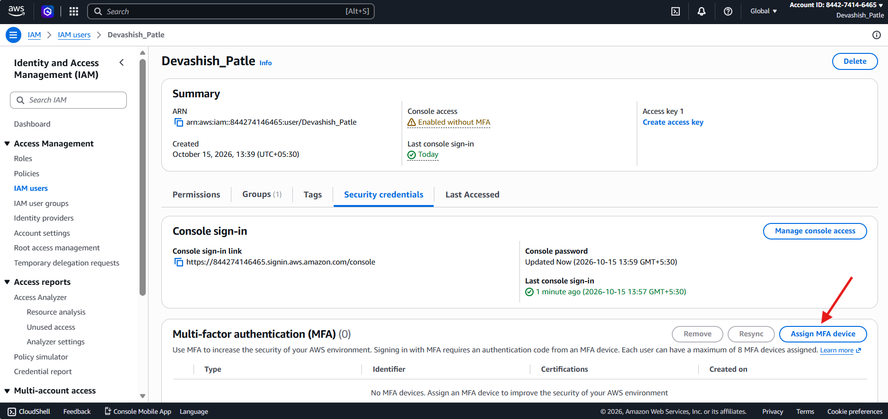

---

## Step 14: Select an MFA Device

1. Enter a device name, such as `Moto-g60`.
2. Under **MFA device**, select **Authenticator app**.
3. Follow the on-screen instructions to continue.

**Description:**

I selected an authenticator app as the MFA method. The app generates verification codes that provide an additional security check during sign-in.

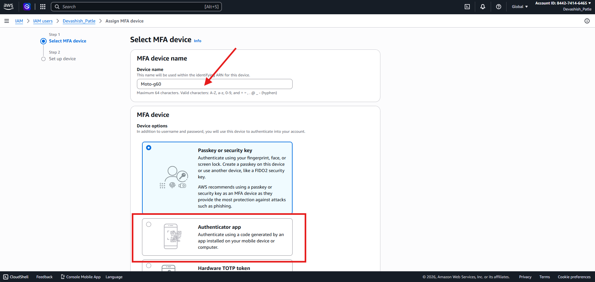

---

## Step 15: Set Up the Authenticator App

1. Open an authenticator app on your phone.
2. Scan the QR code displayed by AWS.
3. Enter the first verification code.
4. Wait for the app to generate the next code.
5. Enter the second verification code.
6. Click **Add MFA**.

**Description:**

I configured the authenticator app by scanning the QR code and entering two consecutive verification codes. This completes the MFA setup if AWS accepts the codes successfully.

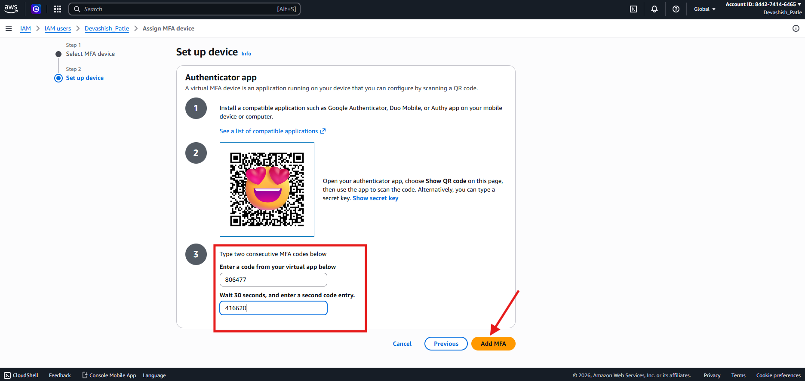
